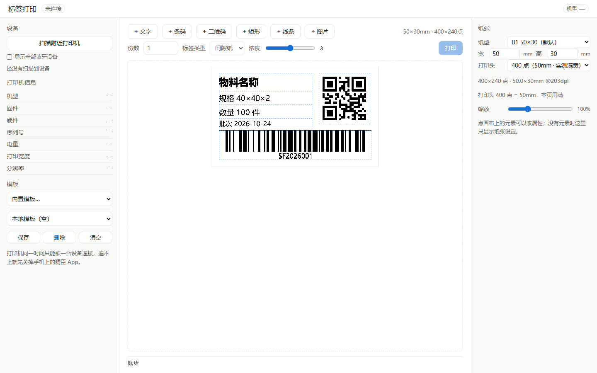
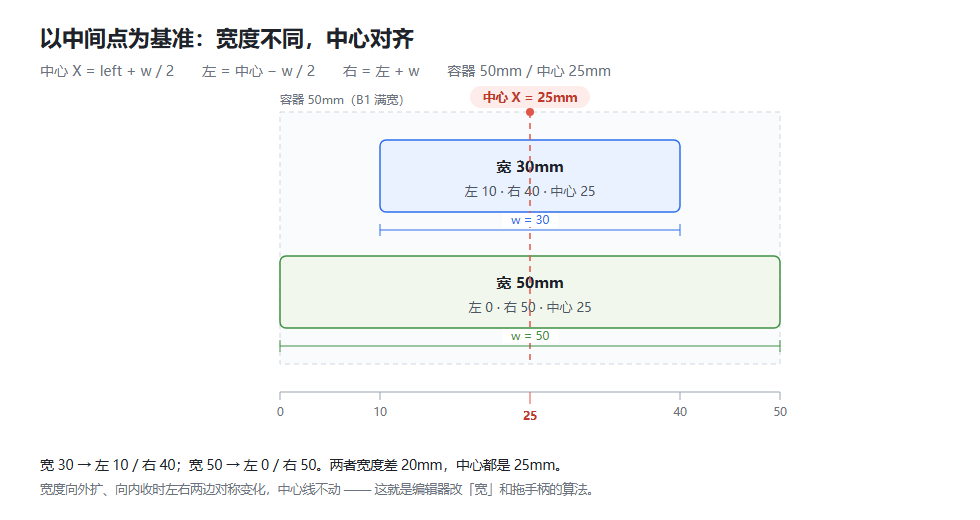
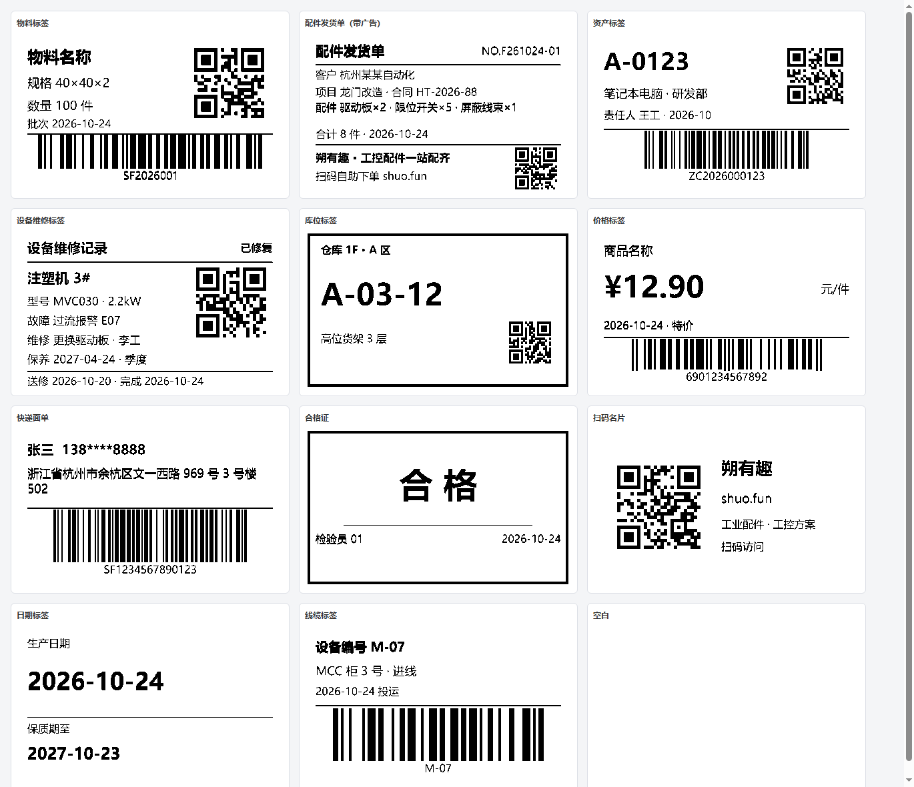
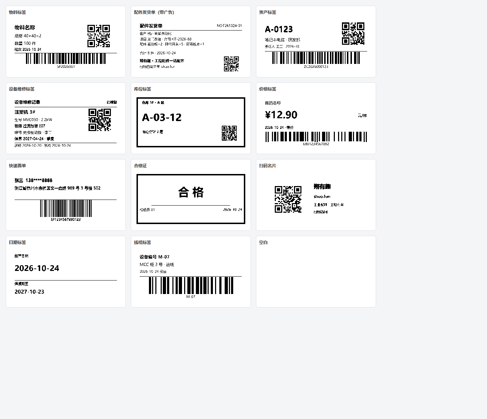

# 标签打印机 App（跨平台）

自己做的标签打印工具，支持 NIIMBOT 系列热敏标签机（B1 / B21 / D110 / H1S）。
Windows / macOS / Linux / Android 一套代码，界面和业务逻辑全部自研。

**下载安装包** → [Releases](https://github.com/shuotianze/LabelPrint/releases/latest)
（Windows 安装器 / 免安装 exe / Android APK，不用自己编译）



## 为什么这么选

打印机协议（命令封装、位图分包、打印任务状态机）已经有成熟的开源实现
`@mmote/niimbluelib`（MIT），支持上列全部机型。把它当成"打印机驱动"直接用，
不重复实现一套；我们自己做的是界面、标签编辑器、打印流程。

| 层 | 内容 | 来源 |
|---|---|---|
| 界面 | 标签编辑器、属性面板、设备面板 | 自己写（原生 DOM + Canvas 2D） |
| 业务 | 标签文档模型、渲染、模板存储 | 自己写 |
| 协议 | 命令/分包/抖动/任务状态机 | niimbluelib（MIT） |
| 传输 | 蓝牙读写 | tauri-plugin-blec（MIT/Apache）+ 自写适配器 |
| 码制 | 一维码 / 二维码生成 | jsbarcode / qrcode（只用于生成位图，不涉及界面） |

## 目录结构

```
label_app/
├── index.html                    入口页（含白屏兜底错误显示）
├── src/
│   ├── main.ts                   应用装配：设备、工具栏、打印
│   ├── styles.css                白色极简样式
│   ├── transport/
│   │   └── blec-client.ts        ★ 蓝牙适配器：把 blec 接到协议栈上
│   ├── core/
│   │   ├── print-service.ts      ★ 打印流程封装
│   │   ├── label-doc.ts          标签文档模型（元素、模板、本地存储）
│   │   ├── presets.ts            12 套内置模板（按 48×30 设计，自动适配纸张）
│   │   ├── align.ts              ★ 以中间点为基准的横向布局（中心 → 左右边界）
│   │   └── units.ts              mm ↔ 点 换算
│   ├── render/
│   │   └── render-label.ts       ★ 把标签文档画成位图（超采样落墨/抖动/居中）
│   └── ui/
│       └── editor.ts             ★ 编辑器：选中、拖拽、缩放、属性面板
├── tests/
│   ├── smoke.html                编辑器冒烟测试（真浏览器里跑，79 项）
│   ├── presets-preview.html      所有内置模板一屏预览，可带 ?w=40&h=20 换纸型
│   ├── zoom-preview.html         单个模板 2 倍放大，用来校对细节（?only=material）
│   ├── align-diagram.html        中心对齐示意图（docs/align-center.png 就出自这里）
│   ├── perf.html                 渲染耗时跑分（拖拽卡不卡看这个）
│   └── text-fit.html             逐条量"文字有没有超出它自己的框"，改字号后先看这页
└── src-tauri/
    ├── Cargo.toml
    ├── tauri.conf.json
    ├── capabilities/default.json  蓝牙权限声明
    └── src/{main.rs,lib.rs}
```

## 跑起来

```bash
npm install          # 首次
npm run app          # = tauri dev，开发模式（自动起 vite + 编译 Rust）
npm run dist         # 打安装包（release，开了 LTO，10 分钟以上是正常的）
```

只调界面（不连打印机）用 `npm run dev`，浏览器打开 http://localhost:1420 。
蓝牙功能在普通浏览器里不可用（没有 Tauri 的 IPC）。

### 安卓

需要 JDK 17 + Android SDK（platform 37 / build-tools 36+）+ NDK 27，装在哪儿都行，
只要把下面三个变量指过去：

```bash
export JAVA_HOME=/path/to/jdk17
export ANDROID_HOME=/path/to/android-sdk
export NDK_HOME=$ANDROID_HOME/ndk/27.2.12479018
npx tauri android build --apk --target aarch64     # 只出 arm64，cargo 有缓存约 4 分钟
```

CLI 只产出未签名的 `app-universal-release-unsigned.apk`，签名得自己做（Tauri 2.12 不再读
`keystore.properties`）。密钥文件和口令都放在仓库外，用环境变量传：

```bash
BT=$ANDROID_HOME/build-tools/36.0.0
"$BT/zipalign.exe" -p -f 4 unsigned.apk release/LabelPrint.apk
"$BT/apksigner.bat" sign --ks "$KS" --ks-key-alias "$KS_ALIAS" \
  --ks-pass env:KS_PASS --key-pass env:KEY_PASS release/LabelPrint.apk
```

三个安卓特有约束，改代码时容易踩：

- **minSdk 必须 ≥ 26**（`src-tauri/gen/android/app/build.gradle.kts`）。蓝牙插件
  `tauri-plugin-blec` 声明 26，模板默认 24，合并清单会直接失败。
- **运行时权限**：安卓 12+ 的 `BLUETOOTH_SCAN` / `BLUETOOTH_CONNECT` 是危险权限，
  不申请就直接扫，系统**不报错**、只是永远扫不到设备。所以 `scanDevices()` / `connect()`
  开头都先 `blec.checkPermissions(true)` 弹窗申请。
- **自适应图标**：只有 mipmap PNG 时，Android 13 的主题图标和部分启动器会显示一片空白。
  `res/mipmap-anydpi-v26/ic_launcher.xml` 必须存在，桌面上才稳定有图标。

冒烟测试：`npm run dev` 后打开 http://localhost:1420/tests/smoke.html ，
页面逐条显示 PASS/FAIL（79 项），覆盖渲染、增删、纸张换算、序列化、
文字居中（数像素算偏差）、中心对齐（宽 30/50 必须同中心）、48/50 两档位图宽度必须不同、换纸型缩放、
落墨后不留灰边、条码明文不被切底，以及 12 套内置模板的元素越界与分隔线不压文字检查。

## 三个必须知道的技术点

### 1. 蓝牙适配器只要 4 个方法，但连上后必须 `emit("connect")`

抽象基类只要求实现 `connect` / `disconnect` / `isConnected` / `sendRaw`。
但基类的构造函数里挂了 `on("connect") → startHeartbeat()`，
**不发这个事件，心跳永远不会启动**，打印机闲置一会儿就休眠断连。

另外两条从官方实现继承来的，不要改：

- **特征值不硬编码**：遍历服务找"支持 notify + 无应答写"的那个。
- **两次写入之间必须 sleep**（`packetIntervalMs`，库默认 10ms）。
  去掉这个间隔，打印会在三分之一处停住，看起来像死机。

### 2. "设备自己断开"的真凶是心跳失败

`fetchHeartbeatData()` 连续失败 `heartbeatMaxFails`（默认 **5**）次就会主动
调用 `disconnect()`，心跳间隔 **2 秒**，也就是**10 秒没响应就被库自己掐掉**。
打印时打印机正忙着走纸，心跳包很容易超时，于是打到一半连接没了。

注意 **`setHeartbeatMaxFails(0)` 不能关掉它**：库里的判断是
`fails > 0 && fails >= maxFails`，传 0 反而变成"第一次失败就断"。

我们的处理（`blec-client.ts` + `print-service.ts`）：

| 措施 | 作用 |
|---|---|
| `setHeartbeatMaxFails(100000)` | 等于关闭库的自动断开，只信蓝牙层的真实掉线 |
| `setHeartbeatInterval(4000)` | 心跳从 2s 放宽到 4s，减少 BLE 占用 |
| 打印前 `stopHeartbeat()`，结束恢复 | 打印期间不产生必然失败的心跳 |

### 3. 单位：模板用毫米，渲染才换点

模板里所有坐标、尺寸都是 **mm**，渲染时按 `dpi` 换算成点
（203dpi 时 1mm = 7.992 点，**不要用整数 8**，否则 100mm 会差 1 个点）。

这样 203dpi 的 B1 和 300dpi 的 B1_PRO 用同一份模板，位置不会跑。

一维码另有硬规矩：条宽必须落在**整数像素**上。所以先生成 1 像素/模块量出
自然宽度，再取整数倍放大，宁可在框里留白也不拉伸——拉伸过的条码扫不出来。

## 文字为什么能正好居中

`textBaseline = "middle"` 对齐的是**字体 em 框中心**，不是墨迹中心。
汉字几乎没有降部（没有 g、y 那种下伸笔画），em 框下半部分空着，
按 em 居中看上去会**整体偏高**约 1/10 字高（实测偏 2.9 个点）。

所以绘制前用纯汉字样本量一次墨迹的 ascent / descent，把整块文字下移
`(ascent - descent) / 2` 作为光学补偿。补偿后实测偏差 **0.09 个点**（约 0.01mm）。

⚠️ 样本字符串不能混进 `g`/`y`：降部会让墨迹上下变对称，补偿值退化成 0，
看上去又偏高了（这个坑踩过一次）。

## 以中间点为基准的横向布局

宽度不同、中心对齐，靠的是一条固定公式（`src/core/align.ts`，坐标单位 mm，原点在标签左上角）：

```
中心 X   cx    = left + w / 2              ← 定义
左边界   left  = cx - w / 2                ← 由中心往左推半个宽
右边界   right = left + w = cx + w / 2     ← 由左边界再走一个宽
```

所以宽度从 30 变到 50、中心不动时：左边 −10mm、右边 +10mm，**中心 X 一个点都不动**。

夹紧规则（默认开启，防止元素跑到纸外）：

```
最小中心 = gutter + w / 2
最大中心 = container - gutter - w / 2
cx 超出区间时整体平移到最近的边界；w 比容器还宽时中心强制落在容器正中，左右溢出量相等
```

参数与默认值：

| 参数 | 含义 | 默认值 |
|---|---|---|
| `widthMm` | 元素宽度 | 必填，下限 1mm |
| `containerMm` | 容器宽度 | **50mm**（B1 实测满宽，默认纸型 50×30） |
| `centerMm` | 中心 X | `containerMm / 2` = **25mm** |
| `gutterMm` | 左右留边 | **0mm**（即整张纸的中心） |
| `clamp` | 是否夹到容器内 | **true** |

纸比打印头宽时，容器取**可打印宽**（纸宽与打印头取小），元素不会被排到打不到的右侧。
这套算法和模板里的 `byCenter()`、编辑器「水平居中」共用同一份实现，不各算一套。

预期结果（容器 50mm、中心 25mm）：

| 元素宽 | 左边界 | 右边界 | 中心 X | 说明 |
|---|---|---|---|---|
| 30mm | **10mm** | **40mm** | **25mm** | 基准情况，两侧各 10mm 余量 |
| 50mm | **0mm** | **50mm** | **25mm** | 铺满纸宽，中心仍对在同一条线上 |
| 60mm | -5mm | 55mm | 25mm | 比纸宽，左右各溢出 5mm（对称） |
| 30mm（要求中心 2） | 0mm | 30mm | 15mm | 贴边被夹紧，整体往右推 |



编辑器里的几处入口用的是同一套算法：

- 「宽」输入框：改宽守住中心（30 → 50 时左右各动 10mm，不是往右长）
- 「中心 X」输入框：直接输入中心，元素整体平移（`x = 中心 - 宽/2`）
- 右下角缩放手柄：鼠标右移 dx，右边 +dx、左边 −dx，宽度按 2×dx 变，手柄跟着指针走
- 「水平居中」按钮：中心 = 纸宽 / 2，元素宽度不同也能对齐到同一条线
- 新建文字默认就是**宽 30、中心对准纸中心**（50mm 纸上落在 x = 10）

## 内置模板

侧边栏 → 模板 → 内置模板，共 12 套，选中即套用，纸张沿用当前设置：

| 模板 | 适合 | 内容 |
|---|---|---|
| 物料标签 | 仓储物料 | 名称大字 + 规格 + 数量 + 批次 + 二维码 + 满宽条码 |
| 配件发货单（带广告） | 售后发货 | 单号 + 客户 + 项目 + 配件清单 + 合计 + **底部广告位（品牌 + 口号 + 二维码，不加框）** |
| 资产标签 | 固定资产 | 编号大字 + 名称部门 + 责任人 + 二维码 + 满宽条码 |
| 设备维修标签 | 设备维保 | 设备名 + 型号 + 故障 + 维修 + 保养 + 状态 + 二维码 + 送修/完成日期（**不放条码**） |
| 库位标签 | 货架/库位 | 外框 + 远距离可读的大号库位号 + 货架层 + 二维码 |
| 价格标签 | 零售 | 品名 + 大价格 + 单位 + 日期 + EAN-13 |
| 快递面单 | 发货 | 收件人电话 + 地址 + 运单条码 |
| 合格证 | 质检 | 外框 + 大字"合格" + 检验员 + 日期 |
| 扫码名片 | 引流 | 二维码 + 品牌名 + 网址 + 一句话介绍 |
| 日期标签 | 食品化工 | 生产日期大字 + 保质期 |
| 线缆标签 | 设备标识 | 设备编号 + 位置 + 投运日期 + 满宽条码 |
| 空白 | 从零搭 | — |

排版规则统一（改模板时照这个来，不然一改就乱）：

- 内容区 **44×26mm**（左右各留 2mm，B1 送纸有轻微偏移，贴边会切字）
- 信息类文字一律**左对齐**，左边界统一在 2mm，形成一条竖线
- 只分三档字号：标题 2.5~3.0mm、正文 2.2~2.3mm、注释 **2.0mm（下限）**
  2.0mm 在 203dpi 上约 16 个点，笔画分得开、半米外也能读；1.7mm 只有 13~14 个点，
  打完偏细，扫一眼容易和旁边的灰点混在一起（这就是原来"小字看不清"的原因）
- 分区用 **0.3mm 细线**，不放大片留白（纸小，留白就是浪费）
- 广告/资料区**不加外框**：0.35mm 的框打出来是一圈黑边，比正文还抢眼
- 二维码 ≥ 7.5mm、一维码 ≥ 6mm 高，低于这个尺寸扫不出来

实现方式：每个模板按 **48×30mm** 写死坐标，再由 `adapt()` 缩放到当前纸张
（默认 50×30 上整体放大 4.5%）。横纵分别缩放、字号取两者较小值，所以 40×20 上不会叠在一起；
二维码会强制回正方形（横纵缩放比不同会让模组变矩形，扫不出来）。

冒烟测试里有一条专门盯版式：**分隔线不许穿过文字**（矩形相交超过 0.2mm 就算失败）。
这条是踩过坑才加的——物料标签的「批次」那行曾被分隔线划掉一半。



换小纸型时同样是等比缩放，元素不会互相压住：



不过 40×20 上内容只剩 0.62 倍，最小字号约 1.25mm（10 个点），能看清但不好扫。
要放二维码和条码，**建议 48×30 或 50×30**（默认就是 50×30）。

## 纸张：纸宽决定位图宽度，打印头只是上限

一条规则：**画布宽度 = min(纸宽, 打印头点数)**。

| 参数 | 作用 | B1 上的值 |
|---|---|---|
| 纸宽 | 这一页的位图有多宽，直接下发给打印机做页宽 | 50mm = 400 点 / 48mm = 384 点 |
| 打印头 | 整机能打到的上限，只用来封顶 | 400 点（机型表写 384，实测能打满 50mm） |

这里曾经有个**"设 48 和设 50 打出来一模一样"**的 bug：画布宽度原来恒等于打印头点数，
纸宽只影响界面上的数字，位图永远是 400 点（50mm），打印机收到的两包数据完全相同。
现在纸宽参与计算，48mm → 384 点、50mm → 400 点，页尺寸包里的 `cols` 跟着变，打印结果才真的不同。

换纸型（预设下拉或改宽高后回车）还会**按比例缩放整版内容**：只改纸、不动内容的话，
模板本来就只用到 46mm，两种纸打出来还是同一张。缩放后坐标、字号、行距一起变，
面板底部会提示"内容按 xx% 等比缩放"。输入框里打字时只改画布不缩放（否则输 "50"
会先按 "5" 缩一次），失焦或回车才缩放。

纸宽大于打印头时，右侧打不到的部分在预览里用**红虚线 + 斜纹「打不到」**标出来；
内置模板也只在可打印宽度内排版，不会把二维码排到打不到的位置。

另外，位图宽度和打印任务的分包宽度必须一致，所以 `print-service.ts` 里把
`task.printheadPixels()` 改写成了画布实际宽度，否则像素计数会算歪。

顺便记一个**改纸时输入框会丢焦点**的坑：原来每次 `setPaperSize` 都重建整个属性面板，
正在输入的 `<input>` 被替换掉，想输 "50" 只能输进去 "5" ——表现就是"设不了 50×30"。
现在改纸只回写数字和画布，控件本身不重建。

## 清晰度：文字为什么要"超采样 + 落墨"

1 位热敏打印只有"打/不打"两档，而 canvas 画字必然带抗锯齿。两个坑都踩过：

| 做法 | 结果 | 原因 |
|---|---|---|
| 原样交给编码器 | 粗体糊、字腔被填死 | 编码器只认纯白 `#ffffff`，**任何灰边都算黑**，等于给每个字描了一圈边 |
| 1 倍画完直接卡阈值 | 2mm 以上干净，1.4~1.8mm 注释字断笔 | 小字只有 11~14 像素高，笔画边缘一半是灰，灰一砍笔画就断 |
| **现在**：3 倍超采样 + 覆盖率落墨 | 大小字号都清楚 | 按 3 倍画，每个输出点看 9 个样本里被笔画盖住多少，超过 40% 就落墨 |

细节配套：

- 文字位图按"内容+字号+对齐+框尺寸"缓存，拖拽时一帧从 18ms 降到 2.2ms
- 水平居中按**墨迹包围盒**对齐（汉字左右字面留白不对称，按字宽居中会偏左半根笔画）
- 矩形/线条一律整数像素实心画，不用 `strokeRect`（描边全是灰边）
- 二维码在"取整后还能保住 85% 尺寸"时按整数倍出图，模组落在整像素上
- 一维码先用 1 像素/模块量自然宽度，再整数倍放大，绝不拉伸
- 一维码的明文**不用** jsbarcode 自带的那套：它把基线放在画布最底边，数字下半截会被切掉；
  改成"条由库画、明文走自己的超采样管线"，还顺手解决了明文比码宽时被左右裁掉的问题
- 折行时英数串整体不拆：`502` 不会被切成 `5` / `02` 两行

## 手机端界面

桌面是三栏（设备 288 | 画布 | 属性 304），在 360px 宽的手机上中间那条缝根本点不着。
所以 ≤860px 时整块换成单栏 + 两个浮层，**断点在 `src/styles.css` 和 `main.ts` 的 `MOBILE_Q`
里各写一份，改要一起改**：

| 桌面 | 手机（≤860px） |
|---|---|
| 左侧栏常驻 | 变成左侧抽屉，标题栏 ☰ 打开，点设备后自动收起 |
| 右侧属性栏常驻 | 变成底部面板，选中元素自动弹出，点空白或「收起」关闭 |
| 画布 1:1 | `editor.fitToWidth()` 按可用宽度拟合缩放，换纸张时重算 |
| 鼠标悬停 | `@media (pointer: coarse)` 把按钮抬到 40px、缩放手柄 9px→18px |

`#inspector` 的内容由编辑器整块重建，所以「收起」按钮和面板外壳放在它的父节点 `.sheet` 上，
不要塞进 `#inspector` 里（会被冲掉）。

看手机布局不用真机：`npm run dev` 后打开 http://localhost:1420/tests/mobile-preview.html ，
用 390×844 的 iframe 模拟；加 `?two=1` 会多一台并自动选中元素，用来看底部面板。

## 已实现功能

- 扫描 / 连接 / 读取机型、固件、硬件、序列号、电量、打印宽度、分辨率
- 纸张尺寸设置：预设 + 自定义宽高（mm），换纸型自动等比缩放版式
- 标签编辑器：文字 / 一维码 / 二维码 / 矩形 / 线条 / 图片
  - 点击选中、拖动移动、右下角拖拽缩放（以中心为基准左右对称伸缩）、方向键微调（Shift 加速）
  - 「宽」「中心 X」双向联动：改宽守住中心，改中心整体平移；一键「水平居中」
  - 文字默认上下左右居中，可单独改水平/垂直对齐
  - 按机型能力自动裁剪"标签类型"和"浓度"选项
  - 图片二值化（阈值可调）/ Floyd-Steinberg 抖动
- 模板：12 套内置模板（自动适配纸张）+ 本地保存 / 载入 / 删除（localStorage）
- 打印：份数、进度条、错误提示

## 开发路线

| 阶段 | 内容 | 状态 |
|---|---|---|
| P0 | 扫描 → 连接 → 读信息 → 打测试图 | 完成 |
| P1 | 画布编辑器（选中、拖拽、缩放、属性面板） | 完成 |
| P2 | 元素：文本 / 条码 / 二维码 / 图片 / 线框 | 完成 |
| P3 | 模板保存与载入 | 完成（本地） |
| P4 | 模板导入导出（JSON 文件）、多机型适配验证 | 待做 |
| P5 | Android 打包（需 NDK）、自动更新 | 待做 |

## 注意

- 官方固件里 App 的"浓度 1~5"并未真正接到打印头，调它没有效果。
  实测有效的是固件内的能量系数（见另一个项目的补丁）。
- 第三方纸在 6.19 固件上会被 RFID 校验直接拒打，需要先刷解锁固件。
